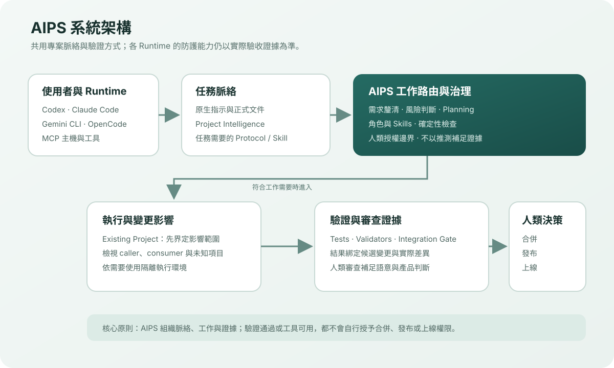
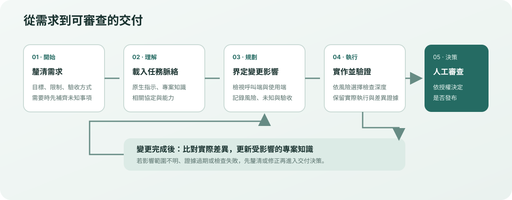

  
AI Product System（AIPS）文件

  
AIPS 是一套跨 Agent 的軟體工程工作系統。它把專案脈絡、工作方法、驗證證據與人類決策邊界接在一起，協助你從需求釐清一路走到可審查的交付成果。

## 依你的目標開始

  <a class="docs-path-card" href="./GETTING_STARTED">
    第一次使用
    <strong>安裝並開始一項工作</strong>
    確認環境、安裝 AIPS，再用自然語言描述目標。
  </a>
  <a class="docs-path-card" href="./USER_GUIDE#existing-project">
    已有程式專案
    <strong>讓 Agent 先理解專案</strong>
    檢視既有指示與變更影響；`.ai/` 專案工作區預設不建立，可選擇 attach。
  </a>
  <a class="docs-path-card" href="./HARNESS">
    整合 Agent
    <strong>設定 Runtime 或 MCP</strong>
    了解各 Agent 的整合方式、能力證據與限制。
  </a>
  <a class="docs-path-card" href="./MAINTENANCE">
    維護 AIPS
    <strong>檢查文件、驗證與發布</strong>
    從維護指南查找一致性、版本與驗收流程。
  </a>

## 系統由哪些部分組成？

下圖呈現 AIPS 的主要邊界：Runtime 接收工作，脈絡層提供專案事實，執行與驗證層產生證據；發布和治理等重要決策保留在人手中。

<figure class="docs-figure">
  
  <figcaption>系統架構：共用工作脈絡與驗證方式，不代表每個 Runtime 都有相同的防護能力。</figcaption>
</figure>

## 一項變更如何完成？

既有專案會先整理變更邊界，再依影響與風險安排執行和驗證。完成證據後，合併、發布或上線仍走各自的授權流程。

<figure class="docs-figure">
  
  <figcaption>工作流程：檢查結果是決策證據；它本身不會授予發布或上線權限。</figcaption>
</figure>

## 文件如何組織

Git／PR 發佈診斷與安全復原請參閱 [User Guide](USER_GUIDE.md)；CLI 錯誤輸出契約由 Scenario 261 覆蓋。

Claude Code 的標準 commit／push／PR 寫法請參閱 Claude Code adapter；由 Scenario 261 覆蓋。

Publication Hook recovery and Required Checks Doctor semantics live in the User Guide and Security Assurance guide; Scenario 261 records their current safe-recovery and candidate-binding contracts.

本機 Creative 工作流支援明確選用已安裝模型與 schema 驗證的 ComfyUI API graph；固定 profile 維持預設，預檢不會啟動推論。

ComfyUI creative model profile registry、已審核拓樸家族、FLUX 3 Klein Base/Distilled sampler profiles、dynamic edit 有序多參考圖，以及 `TextGenerate` runtime schema／最終 payload 預檢的文件入口，請參閱 User Guide、Technology Guide、Security Assurance 及 `orchestration/CREATIVE_DIRECTION.md`；Scenario 236 是合成驗證依據，不代表 MPS 推論已驗證。

OpenCode 原生寫入行為及 READY+STALE 的有限 advisory 邊界，整理於 Harness 與 Project Intelligence；精確的允許／拒絕契約見 Scenario 267。

發布問題排查見使用指南；安全錯誤輸出邊界與 Claude Hook 行為則交叉整理於安全保證、Harness 與 Scenario 261。

| 你想了解 | 建議閱讀 |
| --- | --- |
| 安裝、更新或移除 | [安裝指南](INSTALLATION.md) |
| 日常使用與產品交付 | [使用指南](USER_GUIDE.md) |
| Agent、Runtime 與 MCP 整合 | [Global Harness](HARNESS.md) |
| 專案知識、檢索與變更影響 | [Project Intelligence](PROJECT_INTELLIGENCE.md) |
| 架構邊界與資料流 | [系統架構總覽](ARCHITECTURE_OVERVIEW.md) |
| 能力清單與技術實作 | [系統參考](SYSTEM_REFERENCE.md)、[技術指南](TECHNOLOGY_GUIDE.md) |
| 安全、品質與人工審查 | [安全保證](SECURITY_ASSURANCE.md)、[Conformance 驗證紀錄](CONFORMANCE.md) |
| 維護、版本與文件治理 | [系統維護](MAINTENANCE.md)、[文件導覽](DOCUMENTATION_MAP.md) |

Project Intelligence 的 refresh 與 Retrieval 索引提示依任務範圍判斷（Scenario 269）；細節見 Project Intelligence 與 Harness 文件。

## 閱讀方式

文件以繁體中文說明操作與判斷方式；架構、Runtime、工具及狀態名稱會保留英文，首次出現時補上中文解釋。指令、路徑、設定欄位及錯誤代碼維持原樣，方便直接比對實際輸出。

詳細治理規則與 Agent 執行契約以 repository 中的 canonical 文件為準；這個網站提供使用者導覽、概念說明與操作入口。若文件與目前工具輸出不一致，請以現行程式、設定與驗證結果核對，並依[文件一致性流程](DOCUMENTATION_SYNC.md)回報與修正。
